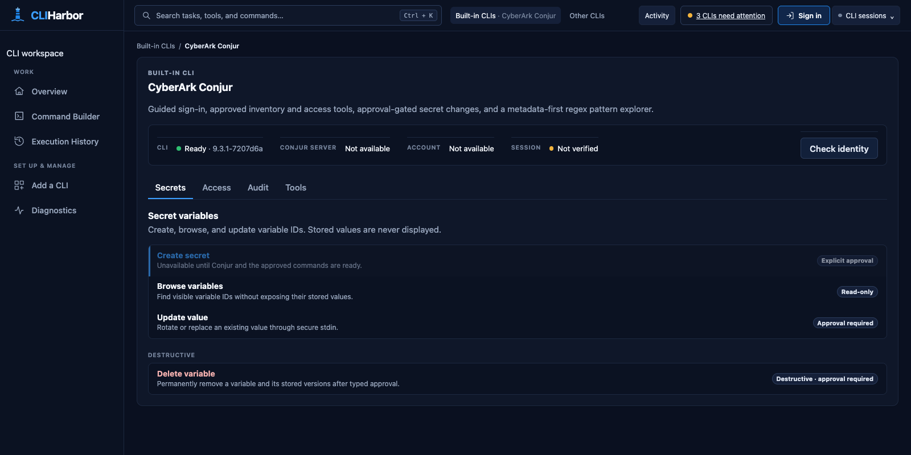
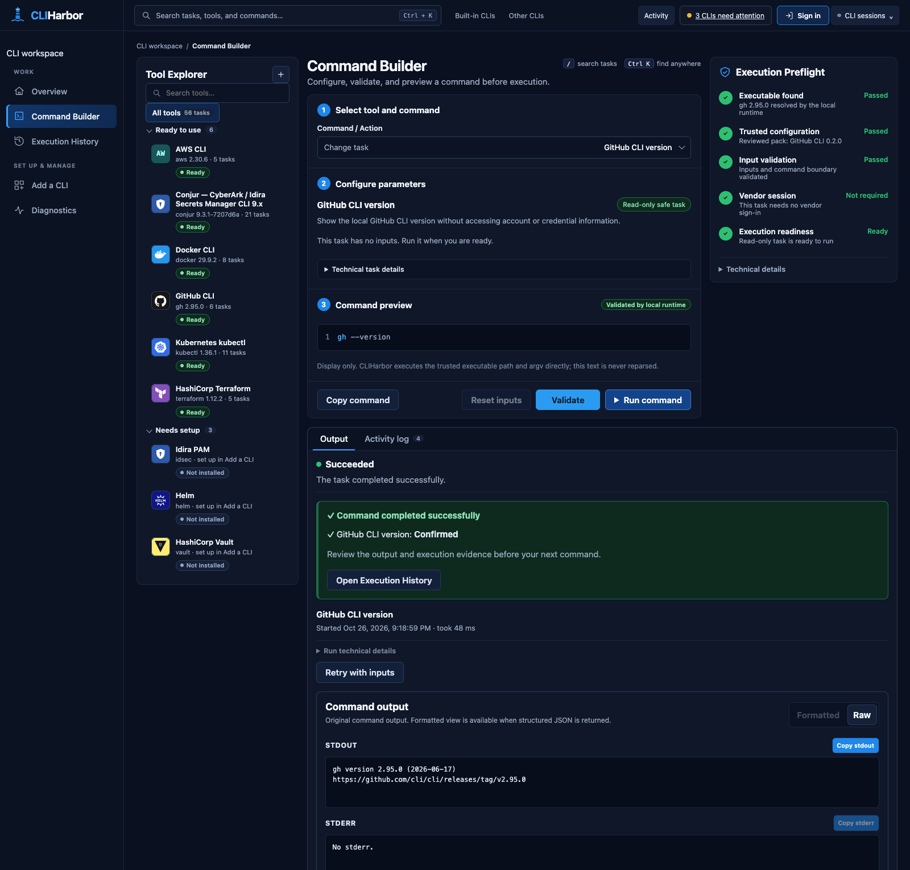
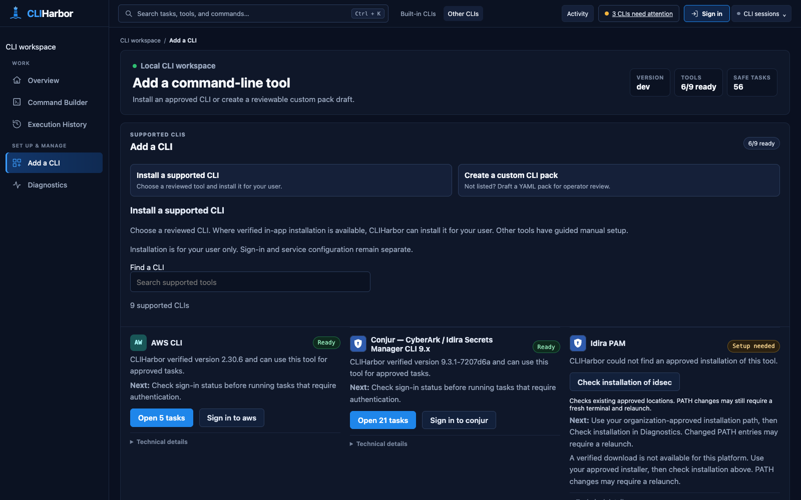

# CLIHarbor

**A local browser workspace for your command-line tools.** Find an approved task, fill in its parameters, review the exact command, and inspect the result—without memorizing flags.

CLIHarbor runs on Windows and macOS. It wraps official CLIs through reviewed, versioned YAML packs, with dedicated workspaces for CyberArk Conjur, Idira PAM, and Terraform. One Go executable carries the browser UI and built-in packs; vendor configuration and durable credentials remain owned by the vendor CLI or OS keystore.



*The Conjur workspace on macOS, before backend configuration or sign-in. Screenshots show the development build; available tasks depend on the tools installed on your computer.*

**Status: active development and hardening.** Reviewed reads, approved Conjur changes, and guarded local Terraform state removal are implemented in source. Native Windows and real-tenant acceptance remain release gates. A successful source build or an older downloaded executable does not qualify the current UI. See [release qualification](docs/ROADMAP.md) and [blocker #59](https://github.com/Quazmoz/CLIHarbor/issues/59).

[Quickstart](#quickstart) · [First task](#run-your-first-task) · [Conjur setup](#conjur-quickstart) · [Supported CLIs](#supported-clis) · [Troubleshooting](#troubleshooting) · [Development](#developer-quickstart)

## Quickstart

Choose the path that matches your computer:

| You have… | Start here | Requirements |
| --- | --- | --- |
| A Mac and a source checkout | [Build and launch on macOS](#macos-build-and-launch) | Git, pinned Go/Node/npm, a browser |
| A managed Windows laptop | [Run a Windows evaluation bundle](#windows-run-an-evaluation-bundle) | An approved, qualified Windows x64 bundle and a browser; no developer tools |
| A Windows development machine | [Developer quickstart](#developer-quickstart) | Git, pinned Go/Node/npm, PowerShell, a browser |

You can open the workspace before installing or signing in to any vendor CLI. A missing optional tool does not prevent ready tools from working. Dependency downloads need network access; service-backed tasks also need the vendor's normal connection and permissions.

### macOS: build and launch

Use Go **1.27.3**, Node **24.21.0**, and npm **>=11.6.0 <12**, as specified in [`.go-version`](.go-version), [`.node-version`](.node-version), and [`web/package.json`](web/package.json). Use your approved toolchain installation method.

From Terminal:

```bash
git clone --branch dev https://github.com/Quazmoz/CLIHarbor.git
cd CLIHarbor

go version
node --version
npm --version

bash tools/dev-restart.sh
```

Already have the checkout? Start from its root and run the version checks and restart helper. The helper installs the locked frontend dependencies, runs typecheck/lint/tests, rebuilds and embeds the frontend, compiles the native executable, and opens the local browser UI. It works on the first launch as well as after edits. If your default Go differs but Go's toolchain selection is available, use `GOTOOLCHAIN=go1.27.3 bash tools/dev-restart.sh`.

**Success looks like:** the terminal reports `Fresh CLIHarbor started`, a new browser tab opens on `http://127.0.0.1:<ephemeral-port>`, and **Overview** offers **Open tasks** or setup guidance. Use the newly opened tab: each launch gets a new port and local browser session.

The helper uses `--no-auto-setup`; it does not download a vendor CLI automatically. On macOS, open **Add a CLI** to install Conjur, kubectl, or GitHub CLI where a reviewed artifact is offered. Installation is a separate, explicit action and does not sign you in.

To stop the helper-owned instance:

```bash
bash tools/dev-restart.sh --stop
```

For platform limits and an approved executable outside discovery locations, see [Windows and macOS setup](docs/CROSS_PLATFORM.md).

### Windows: run an evaluation bundle

This path needs no administrator account, Go, Node/npm, Git, or PowerShell.

1. Open the repository's [manual CI workflow](https://github.com/Quazmoz/CLIHarbor/actions/workflows/ci.yml). Use an existing successful, explicitly authorized `main` run for the exact commit approved for evaluation. Download `cliharbor-windows-x64-evaluation-<commit-sha>` from **Artifacts** and record the SHA. If no qualified artifact is available, evaluation must wait for qualification; do not substitute a development EXE.
2. Extract the complete ZIP into a user-writable folder, such as `%USERPROFILE%\Downloads\CLIHarbor-Eval`. Keep the extracted bundle unchanged:

   ```text
   EVALUATION_SHA256SUMS
   bin/
     cliharbor-windows-x64-evaluation.exe
   packs/phase0/
     idira-cyberark-inventory.yaml
   ```

3. Open a normal **Command Prompt**, change to that folder, and run preflight:

   ```bat
   cd /d "%USERPROFILE%\Downloads\CLIHarbor-Eval"
   bin\cliharbor-windows-x64-evaluation.exe evaluation preflight --bundle "."
   ```

   Continue only when the final status is `READY FOR PHASE 0 INVENTORY`. Preflight checks the bundle and local runtime; it does not install a CLI or authenticate to a vendor.
4. Start the workspace:

   ```bat
   bin\cliharbor-windows-x64-evaluation.exe
   ```

The browser opens automatically. Built-in packs are embedded; no separate Conjur pack download or `--pack-file` is needed. When Conjur is genuinely missing, normal Windows x64 startup may download and verify the pinned official Conjur 9.3.1 executable into the current user's cache. It does not replace ambiguous, incompatible, or explicitly selected installations.

If application-managed downloads are prohibited, start with:

```bat
bin\cliharbor-windows-x64-evaluation.exe serve --no-auto-setup
```

Keep the terminal running while using a manually launched instance; press **Ctrl+C** there to stop it. Application-control blocks require the organization's approved signing/allowlisting process. See [QUICKSTART.md](QUICKSTART.md) for the complete evaluation procedure and [work-laptop acceptance](docs/WORK_LAPTOP_EVALUATION.md).

GitHub Actions workflows are **manual-only**. These instructions do not authorize a dispatch; running Actions requires specific user authorization.

## Run your first task

Start with a local version task to verify the workspace without a vendor account or service connection:

1. Open **Add a CLI** and check that your chosen tool is **Ready**. If needed, use an offered **Install** action or the approved manual setup guide, then **Check installation**. You do not need every listed CLI.
2. Open **Command Builder**. Use **Find task** in the top bar, **Command+K** on macOS / **Ctrl+K** on Windows, or the task catalog to select **GitHub CLI version**. If GitHub CLI is unavailable, **Terraform CLI version** or **AWS CLI version** provides another local check when that tool is installed.
3. Choose **Validate**. The command preview should show the runtime-validated invocation—for example, `gh --version`—and the preflight panel should report that no vendor sign-in is required.
4. Choose **Run command**. Wait for **Succeeded**; expand **Run technical details** to inspect the run ID and exit code. A successful version check exits with `0`.
5. Read **Command output → Raw**. Stdout and stderr are separate. **Formatted** becomes available for supported structured output. Open **Execution History** to revisit the retained run.



*This example runs the installed official `gh` executable locally. It does not access GitHub accounts or credentials. Tool versions and counts in the screenshot are examples, not prerequisites.*

Read-task output and history are bounded and kept in memory; restarting CLIHarbor clears them. Approved mutations have a separate persistent metadata-only [audit journal](docs/MUTATION_AUDIT.md). Neither opening a task nor selecting a search result executes a command.

## Conjur quickstart

1. In **Add a CLI**, confirm that **Conjur — CyberArk / Idira Secrets Manager CLI 9.x** is ready. Existing approved installations are preferred; supported missing-tool installs are available for Windows x64 and macOS Intel/Apple Silicon. The reviewed compatibility range is `>=9.3.1-0 <10.0.0-0`.
2. Open the top-bar **Sign in** page. Use the Conjur card's **settings** control to inspect or configure the backend when offered. Installing the executable, configuring its connection, and authenticating are separate steps.
3. For eligible HTTPS self-hosted standard/LDAP configurations, complete connection setup first, then use **Sign in and verify**. CLIHarbor passes the password transiently to the reviewed vendor authentication adapter; it never puts it in task arguments, history, or its own persistent storage.
4. For OIDC/JWT/SaaS on **macOS**, complete the official `conjur login` flow in your terminal, then return to **Check session**. On **Windows**, use **Start official Conjur sign-in** when offered and complete the vendor-owned browser/terminal flow. Other modes follow your organization's approved vendor process.
5. Continue only after the reviewed session check succeeds. Open **Built-in CLIs → CyberArk Conjur** and start with **Tools** inventory tasks or the **Access** explorer. A ready executable alone is not proof of authentication.

The **Secrets** tab provides guided creation, variable-ID browsing, write-only value updates, and typed-confirmation deletion. Changes require backend-bound approval; multi-step creation can partially complete and is not an atomic transaction. The **Audit** tab's regex explorer searches variable IDs by default; value scanning is an explicit opt-in and never returns secret values. The **Tools** tab includes migration playbooks and review-only policy templates.

See [Conjur integration](docs/CONJUR_INTEGRATION.md), [authentication boundaries](docs/AUTHENTICATION.md), and [mutation audit and recovery](docs/MUTATION_AUDIT.md). Real-tenant acceptance remains required before release use.

## Configure the Conjur API backend (SaaS)

Open **Sign in → Conjur settings → Conjur API connection**. Use your organization's Secrets Manager **API service URL**, shaped like `https://<tenant>.secretsmgr.cyberark.cloud`, rather than its separate Identity website.

When supported, CLIHarbor delegates setup to the verified official CLI with reviewed `conjur init saas` arguments and reads the saved vendor configuration back. Replacing an eligible existing SaaS endpoint requires **Change API endpoint** and explicit acknowledgement. After any change, sign in again and run **Check session**. If saving fails or its outcome is unclear, use **Retry reading CLI configuration** before another attempt.

Existing unsupported modes remain vendor-configured. CLIHarbor does not disable TLS checks, edit credentials, or save an unrelated browser-only endpoint. See [SaaS connection behavior](docs/AUTHENTICATION.md#actual-conjur-api-connection-setup--saas).

## Supported CLIs

The built-in catalog currently includes nine CLIs. Only compatible, identity-verified tools contribute executable tasks. See the [CLI catalog](docs/CLI_CATALOG.md) for pinned downloads, platform coverage, and installation contracts.

| CLI | Available workflows | Setup |
| --- | --- | --- |
| CyberArk Conjur | Identity, resource/role inventory, access exploration, approved variable/permission changes, regex explorer | Existing installation or reviewed Windows/macOS download; vendor sign-in |
| Idira PAM (`idsec`) | Bounded, read-only Safe/account metadata and session checks; candidate pending Windows/tenant acceptance | Approved existing v0.13.x installation; vendor-owned setup/login |
| Docker | Context, narrow inventory, disk usage, one-shot resource statistics | Approved CLI and accessible engine |
| Kubernetes kubectl | Context, metadata inventory, optional Metrics API snapshots | Existing installation or reviewed download; configured cluster access |
| GitHub CLI | Bounded repository, issue, PR, workflow, and run metadata; local version | Existing installation or reviewed download; vendor session for service tasks |
| AWS CLI v2 | Caller identity and selected S3/EC2/Lambda metadata; local version | Existing installation and normal profile/SSO session |
| Helm | Release/history/repository metadata | Existing installation; reviewed download on Windows only |
| HashiCorp Vault | Server status and mount/policy-name metadata | Existing installation and vendor configuration/session |
| HashiCorp Terraform | Offline help/version, approved local configuration formatting checks, state-address inventory, guarded local state removal in dev | Approved existing CLI; startup-approved project roots; Windows qualification pending |



*The catalog distinguishes installed tools from setup requirements. An Install action appears only for a missing tool with a reviewed artifact for the current platform.*

Installations stay in the current user's scope. Download URLs, versions, hashes, archive members, and executable names come from trusted packs. An optional custom install base must remain under your user home. Successful supported installation qualifies the tool and publishes its tasks without restarting; sign-in remains separate.

For Terraform, project directories must be approved at startup with `--terraform-project <absolute-directory>`. Browsing local state returns address metadata, not attributes or outputs. Guarded state removal delegates to the official CLI and forgets tracking; it does not destroy infrastructure, and a later apply can recreate declared resources. Remote backends, plan/apply/destroy, and provider-dependent validation are unavailable. Follow the [Terraform guide](docs/TERRAFORM_INTEGRATION.md) for the exact development and qualification boundaries.

## Troubleshooting

| Symptom | Next step |
| --- | --- |
| Build or frontend checks fail | Fix the first reported `task:` failure. Do not launch an older executable. Verify the pinned toolchain versions. |
| Browser does not open | If startup prints a one-time bootstrap URL, open it locally in your browser. Treat it as a credential and do not share it. The plain base URL alone does not establish a fresh session. |
| Old tab is disconnected or shows an old UI | Use the new tab from the restart helper. React changes require a frontend rebuild; `go run ./cmd/cliharbor serve` alone does not rebuild React. |
| No tasks for a CLI | Open **Add a CLI** or **Diagnostics**. Missing, unsupported, incompatible, and ambiguous tools remain unavailable. Other ready CLIs can still run. |
| Installed a CLI, but it is still missing | Use **Check installation** where offered. A changed PATH may require stopping CLIHarbor and relaunching from a fresh terminal. A page refresh does not repeat discovery. |
| Tool is ambiguous or outside discovery locations | Review local `doctor` output and restart with one approved absolute `--tool-path "pack-id/tool-id=/absolute/path"`. An invalid explicit override does not fall back. |
| Tool is ready, but a service task fails | Open **Sign in** and use the reviewed session check where available. Verify vendor endpoint/context, network access, and permissions; installation does not prove a usable session. |
| Windows preflight is blocked | Follow its remediation and stop evaluation. Keep the complete extracted bundle unchanged; write evidence outside it. |
| Startup says the audit trail is locked | Stop the other CLIHarbor instance through its own terminal or the helper that owns it. Do not delete the lock. |
| Audit journal fails verification | Preserve it and follow [incident handling](docs/MUTATION_AUDIT.md#incident-handling-journal-fails-verification). Do not delete or edit it to force startup. |
| Application or vendor download is blocked by policy | Use the approved installation/signing/allowlisting path. Do not bypass device controls. |

After a macOS source build, local checks are available with:

```bash
./bin/cliharbor version
./bin/cliharbor self-test
./bin/cliharbor doctor
./bin/cliharbor help serve
```

`self-test` exercises local runtime primitives without accessing vendor CLIs, credentials, or external endpoints. `doctor` reports discovery/version state without downloading dependencies; it can exit `1` for unavailable optional tools even when the browser workspace is usable. Its output can include filesystem paths—review before sharing.

For an allowlisted support artifact, choose a **new** output filename:

```bash
./bin/cliharbor diagnostics export ./cliharbor-diagnostics.json
```

The export excludes command output, argv, paths, environment values, browser secrets, and credentials. It does not upload anything. On a Windows evaluation machine, use the packaged executable and write the file **outside** the immutable extracted bundle. See [diagnostic export](docs/SECURITY.md#7-logging-diagnostics-and-evidence).

## Security model

CLIHarbor's execution boundary is:

```text
reviewed pack + verified executable + validated typed inputs
    → exact executable path and argument vector
    → bounded process execution → structured or raw results
```

- **Local browser boundary:** an ephemeral IPv4 loopback listener, one-use bootstrap, HttpOnly session cookie, exact Host/Origin checks, CSRF protection, and restrictive browser headers.
- **Explicit command authority:** packs allowlist executable names, commands, flags, and validation. Browser input never becomes arbitrary shell syntax or executable selection. Ambiguity or changed executable identity blocks execution.
- **Vendor-owned authentication:** CLIHarbor does not persist vendor passwords, MFA responses, API keys, or tokens. Narrow reviewed sign-in and write-only secret-input flows keep secrets out of task argv and run history. Ordinary task execution reuses vendor sessions.
- **Deliberate changes:** mutating workflows require reviewed context and backend approval. Destructive actions add explicit target confirmation. Mutation journaling fails closed; automatic undo is unavailable.
- **Faithful evidence:** runs have stable IDs, tool versions, timestamps, status, and exit codes; stdout/stderr stay separate and are rendered as untrusted text. Parser failure preserves raw evidence.

There is no cloud backend or telemetry by default. Wrapped CLIs still contact their configured services, and approved downloads still use the network. CLIHarbor is not a remote multi-user server, generic shell, or credential vault. See [Security](docs/SECURITY.md) and [Architecture](docs/ARCHITECTURE.md).

## Add another CLI without changing Go code

Open **Add a CLI → Create a custom CLI pack → Start authoring** to download a discovery-only YAML draft. It contains no runnable commands, probes, installer, or authentication adapter and is not automatically trusted or loaded.

Alternatively, after a native source build:

```bash
./bin/cliharbor pack init --id acme-cli --name "Acme CLI" --tool acme --executable acme ./acme.yaml
./bin/cliharbor pack validate ./acme.yaml
./bin/cliharbor pack lint ./acme.yaml
```

Add only independently reviewed command, input, output, and probe contracts. Validate and lint again, then inspect discovery and load the approved pack explicitly:

```bash
./bin/cliharbor doctor --pack-file ./acme.yaml
./bin/cliharbor serve --no-auto-setup --pack-file ./acme.yaml
```

Stop any running instance before starting another. Custom packs are additive to the embedded set; `--no-default-packs` selects a custom-only runtime. Custom IDs must not impersonate built-in packs. Validation establishes validity, not trust or vendor correctness.

The [pack specification](docs/PACK_SPEC.md#18-pack-authoring-commands) covers fixed help capture, non-executable drafts, static compatibility reporting, and planner-contract generation/testing. Captured help and generated tests never authorize a command automatically.

## Developer quickstart

Use the pinned toolchains listed in the macOS quickstart, clone **`dev`**, and work from the repository root. The frontend is embedded in the Go executable; use the restart helpers even for the first launch.

| Action | macOS / Linux | Windows PowerShell |
| --- | --- | --- |
| Validate, rebuild, and launch | `bash tools/dev-restart.sh` | `.\tools\dev-restart.ps1` |
| Stop the helper-owned instance | `bash tools/dev-restart.sh --stop` | `.\tools\dev-restart.ps1 -Stop` |
| Intentionally update from upstream, then restart | `bash tools/dev-restart.sh --pull` | `.\tools\dev-restart.ps1 -Pull` |

Before adopting a helper, stop manually launched CLIHarbor/Vite processes through their own terminals. Use restart only when no vendor operation or sign-in is in flight. The helpers verify their own process ownership; they do not stop unrelated listeners or clear browser/vendor credentials. Invoke the Windows script as a file; if PowerShell shows `>>`, press **Ctrl+C** before retrying. Follow approved execution policy rather than weakening it.

An optional fast-forward pull requires resolved local changes. Never reset/clean away work to restart. Builds may update `internal/webui/static/`; commit generated assets with frontend source changes. Startup logs under ignored `bin/` are private and may contain a bootstrap URL.

### Verification commands

Run the repository-owned local gate before committing:

```bash
go run ./tools/task check
```

The gate includes frontend checks/build, embedded-source synchronization, Go module verification, and Go formatting/vet/tests. A regenerated embedded tree must be committed before the synchronization gate passes. A matching source fingerprint alone does not prove the JavaScript was rebuilt.

On macOS, a symlinked Terraform installation can make the real-state-removal integration test fail with `invalid argument`. Set `CLIHARBOR_TEST_TERRAFORM` to the approved **resolved executable file** (for example, the actual Homebrew Cellar path) when running the gate. The override selects the real CLI; it does not skip the integration test or relax identity checks.

Additional focused gates:

```bash
go test -race -timeout 2m ./...
go run ./tools/task verify-web-sync
```

On macOS/Linux with Node 24 and Chrome/Chromium, the existing hermetic browser gate is:

```bash
CLIHARBOR_BROWSER_E2E=1 go test -timeout 90s -count=1 -run '^TestProductionEmbeddedBrowserE2E$' ./internal/app
```

For Vite live development, use two terminals:

```bash
# Terminal 1
go run ./tools/task web-dev

# Terminal 2
go run ./cmd/cliharbor serve --no-auto-setup --web-dev-url http://127.0.0.1:5173
```

Open the **Go runtime's** browser tab so bootstrap and API requests remain on the authenticated loopback origin. Production builds use `web/` as source and `internal/webui/static/` as generated output; never edit the latter manually. See [test strategy](docs/TEST_STRATEGY.md) for security, dependency, native Windows, and release qualification gates. Local builds and cross-compilation do not replace target-host acceptance.

### Development branch workflow

- **`dev`:** routine implementation and PR base, even when GitHub displays `main` by default.
- **`beta`:** reviewed integration and acceptance candidate; promote only after the applicable gates pass.
- **`main`:** stable baseline, receiving expressly requested, qualified promotions from `beta` or validated urgent hotfixes.

A branch name is not evidence of a qualified binary. Do not automatically dispatch GitHub Actions or promote a development build. [AGENTS.md](AGENTS.md) defines the authoritative branch, validation, and manual Actions policy.

## Repository layout

```text
cmd/cliharbor/           CLI entry point and operator commands
internal/app/            runtime lifecycle and platform wiring
internal/server/         loopback HTTP, session, origin, and CSRF boundary
internal/packs/          pack loading, schema, and validation
internal/discovery/      executable discovery, version, and identity
internal/planner/        typed inputs → exact execution plans
internal/executor/       bounded direct process execution
internal/runs/           run state, events, and replay
internal/audittrail/     durable mutation metadata journal
internal/platforms/      dedicated Conjur, Idira PAM, and Terraform behavior
internal/toolbootstrap/  reviewed portable CLI installation
internal/webui/static/   generated embedded frontend
web/                    React + TypeScript + Vite source
packs/                  reviewed built-ins and explicit test fixtures
schemas/                embedded pack schema
tools/                  build, verification, and restart helpers
docs/                   product, security, integration, and operator guides
```

## Documentation

| Guide | Use it for |
| --- | --- |
| [Windows evaluation quickstart](QUICKSTART.md) | Complete non-admin download, preflight, startup, and recovery procedure |
| [Windows and macOS setup](docs/CROSS_PLATFORM.md) | Platform boundaries, native builds, discovery, and overrides |
| [Supported CLI catalog](docs/CLI_CATALOG.md) | Install artifacts, platforms, and activation rules |
| [Conjur integration](docs/CONJUR_INTEGRATION.md) | Upstream provenance, inventory, access, approvals, and migration tools |
| [Idira PAM integration](docs/IDIRA_PAM.md) | Reviewed idsec scope and work-laptop acceptance |
| [Terraform integration](docs/TERRAFORM_INTEGRATION.md) | Approved roots, configuration checks, guarded state removal, and recovery |
| [Docker](docs/DOCKER_INTEGRATION.md), [kubectl](docs/KUBECTL_INTEGRATION.md), [GitHub CLI](docs/GITHUB_INTEGRATION.md) | Reviewed read-only command scope |
| [Mutation audit and recovery](docs/MUTATION_AUDIT.md) | Persistent audit metadata, integrity failures, and recovery limits |
| [Work-laptop evaluation](docs/WORK_LAPTOP_EVALUATION.md) | Managed Windows and real-vendor acceptance |
| [PRD](docs/PRD.md), [UX](docs/UX.md), [Roadmap](docs/ROADMAP.md) | Product intent, operator experience, and qualification work |
| [Architecture](docs/ARCHITECTURE.md), [Decisions](docs/DECISIONS.md) | Component boundaries and accepted ADRs |
| [Security](docs/SECURITY.md), [Authentication](docs/AUTHENTICATION.md) | Threat model, credentials, and session ownership |
| [Pack specification](docs/PACK_SPEC.md) | Declarative allowlists and authoring tools |
| [Development plan](docs/DEVELOPMENT_PLAN.md), [Test strategy](docs/TEST_STRATEGY.md) | Implementation and verification contracts |
| [Screenshot notes](docs/images/README.md) | Capture provenance and refresh guidance |
